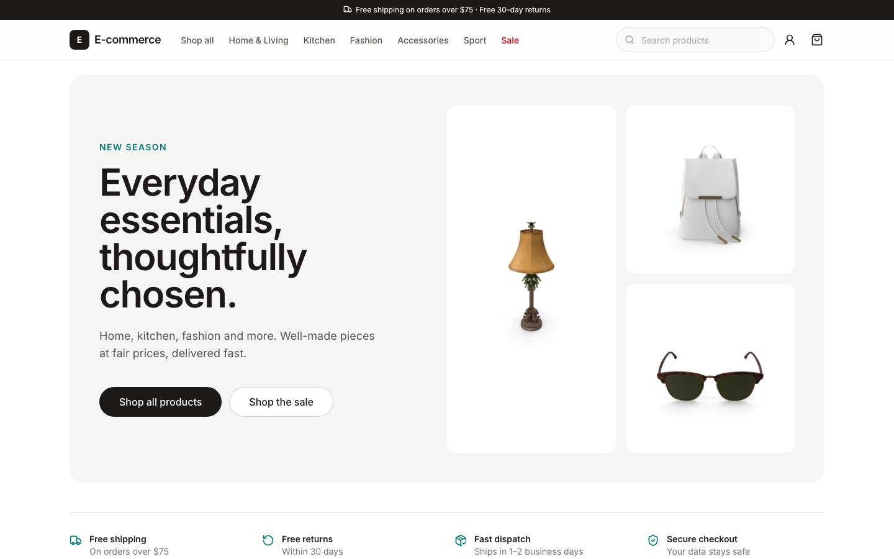
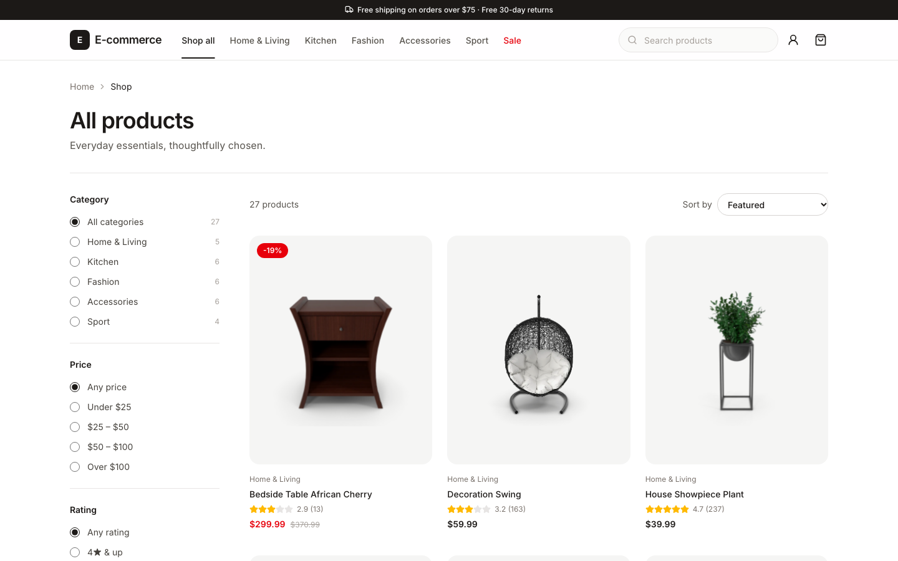
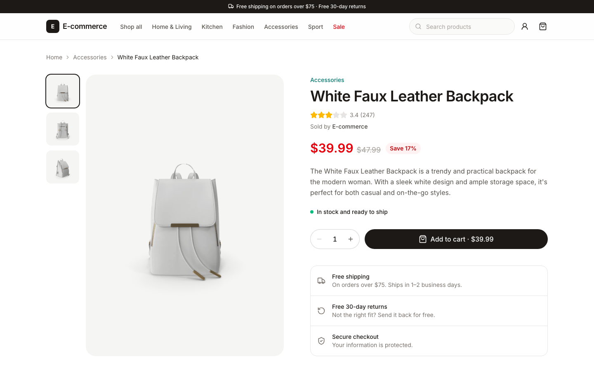

# E-commerce: full stack online store

A responsive online store with accounts, roles, a server-side cart, real orders and an admin dashboard.

**Live demo:** https://shop-web-lime.vercel.app · **API:** https://shop-silk-gamma.vercel.app/api/products

Demo login: `buyer@ecommerce.test`, `seller@ecommerce.test` or `admin@ecommerce.test` (ask me for the demo password).
The API runs on Vercel serverless functions and the database is PostgreSQL on Neon.

**Frontend:** React 19 · TypeScript · Tailwind CSS v4 · React Router · Vite
**Backend:** Node.js · Express 5 · PostgreSQL · JWT authentication · bcrypt



| Shop with filters | Product page |
| --- | --- |
|  |  |

## Features

**Shopping**
- Home page with hero, category tiles, top-rated and on-sale sections
- Shop page with search, category, price and rating filters, "on sale" toggle and sorting.
  Filters live in the URL (`/shop?category=kitchen&sort=price-asc`), so they can be shared and bookmarked
- Product page with image gallery, stock status, quantity selector and related products
- Cart drawer and cart page with a free-shipping progress bar

**Accounts and roles**
- Sign up as a **buyer** or a **seller**; passwords hashed with bcrypt, sessions with JWT
- **Sellers** list their own products and remove them
- **Moderators** can remove any product
- **Admins** manage user roles, see the dashboard and manage every order

**Cart and orders**
- Guests keep their cart in the browser; after login it is merged into the account and saved in the database
- Checkout sends only product ids and quantities: the server looks up prices, recomputes totals,
  checks stock, saves the order, reduces stock and empties the cart in a single transaction
  (rows are locked with `SELECT ... FOR UPDATE`, so two buyers can't both get the last item)
- Order history with status tracking

**Admin dashboard**
- Revenue, order, product and user totals, low-stock alerts, users by role
- Orders table with status filters; cancelling an order puts the items back in stock

**Quality**
- Accessible: semantic HTML, labels, ARIA attributes, keyboard support, focus management
- Server-side validation on every endpoint, parameterized SQL queries, consistent JSON errors

## Run locally

Requirements: Node.js 24+ and PostgreSQL.

```bash
# 1. API
cd server
npm install
cp .env.example .env      # set your PostgreSQL password and a JWT secret
npm run db:setup          # creates the database, tables, 27 products and demo accounts
npm run dev               # http://localhost:3001

# 2. Store (in a second terminal, from the project root)
npm install
npm run dev               # http://localhost:5173
```

Demo accounts (password = `DEMO_PASSWORD` in `server/.env`): `admin@ecommerce.test`,
`moderator@ecommerce.test`, `seller@ecommerce.test`, `buyer@ecommerce.test`.

## Project structure

```
src/                      React app
  api/                    fetch wrapper (base URL, token, errors)
  components/             layout, product, cart, orders, shop filters, auth guard, UI kit
  context/                auth, products and cart state (React Context)
  hooks/                  useApiData
  pages/                  shop pages, account pages, seller dashboard, admin pages
  types/ utils/           shared types, pricing, filtering, formatting, storage
server/                   REST API
  db/                     schema.sql, seed.sql
  src/                    Express app, auth middleware, pricing, routes, setup script
```

See [server/README.md](server/README.md) for the API endpoints.

## Deployment

- **Website:** Vercel static hosting, built with `npm run build`. `vercel.json` sends every path to `index.html`
  so React Router can handle routes like `/shop` and `/cart`.
- **API:** the `server/` folder as a second Vercel project (Express runs as a serverless function).
- **Database:** PostgreSQL on Neon, connected to the API through the `DATABASE_URL` environment variable.
- Every push to `main` redeploys both automatically.

## Credits

- Product names, descriptions and photos are demo data from [DummyJSON](https://dummyjson.com),
  a free fake-data API for prototypes. They are placeholders, not real products for sale.
- Font: [Inter](https://rsms.me/inter/) by Rasmus Andersson (SIL Open Font License), via Google Fonts.
- Icons: [Lucide](https://lucide.dev) (ISC License).
